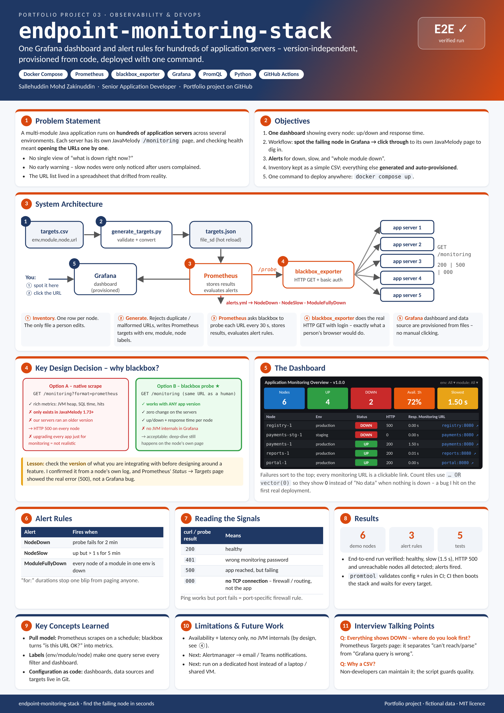

# endpoint-monitoring-stack


| [How to use](docs/USAGE.md) | [Design document](docs/DESIGN.md) | [Poster (PDF, A3)](docs/poster.pdf) | [Changelog](CHANGELOG.md) |
|---|---|---|---|

<a href="docs/poster.png"></a>

One Grafana dashboard for the health of many application servers, built with **blackbox_exporter + Prometheus +
Grafana** in Docker Compose. Maintain a simple `targets.csv` inventory and the rest is generated and provisioned
automatically.

## Background

At work, checking the health of a multi-module Java application meant opening each server's JavaMelody
`/monitoring` page one by one - hundreds of URLs across several environments. I built a dashboard so the workflow
became: **find the failing node in Grafana, then click through to its own monitoring page to dig in.**

The interesting design decision: Prometheus can normally scrape JavaMelody directly (`?format=prometheus`),
but that endpoint only exists from JavaMelody 1.73 onwards. Our servers ran an older version, and requesting it
returned HTTP 500 on every node. Upgrading every application just for monitoring was not realistic, so I switched
to **blackbox_exporter**, which simply performs an authenticated HTTP GET on the normal monitoring URL and records
whether it succeeded and how long it took. It works with any application version.

This repo is a generic, self-contained rebuild of that setup. Hostnames, credentials and services are fictional; the
`mock/` service stands in for real application servers.

## Architecture

```
targets.csv --(scripts/generate_targets.py)--> prometheus/targets/targets.json   (file_sd, hot-reloaded)
                                                        |
   Grafana  <--  Prometheus  --/probe?target=URL-->  blackbox_exporter  --HTTP GET + basic auth-->  app servers
 (dashboard)    (alerts.yml)
```

## Quick start

```bash
make demo        # or: python3 scripts/generate_targets.py && docker compose --profile demo up -d --build
```

- Grafana: http://localhost:3000 (admin / admin) - the dashboard opens as the home page
- Prometheus: http://localhost:9090 (check **Status -> Targets** and **Alerts**)

The demo includes deliberately unhealthy services so every panel has something to show:

| Node | Behaviour |
|---|---|
| portal-1, portal-stg-1 | healthy |
| payments-1 | healthy but slow (1.5 s) -> `NodeSlow` |
| registry-1 | HTTP 500 -> `NodeDown`, `ModuleFullyDown` |
| reports-1 | fails ~40% of probes (flaky) |
| payments-stg-1 | host does not exist (simulates DNS / firewall block) |

## Dashboard

- Stat tiles: nodes monitored / UP / DOWN, availability over the last hour, slowest probe
- **Node status table** sorted with failures first; the monitoring URL is a clickable link
- Response time per node (early warning before a node drops) and nodes-down over time
- `env` and `module` filters

Lesson learned: a stat panel built on `count(probe_success == 0)` shows **"No data"** instead of `0` when nothing
is down, because the query returns an empty result. Every count panel uses `... OR vector(0)`.

## Alerts (`prometheus/alerts.yml`)

| Alert | Condition |
|---|---|
| NodeDown | probe failing for 2 minutes |
| NodeSlow | successful but slower than 1 s for 5 minutes |
| ModuleFullyDown | every node of a module in an environment is down |

Hook these up to email / Teams / Slack by adding Alertmanager.

## Using it with real servers

1. Remove the mock services (or just run `make up` without the demo profile).
2. Put your servers in `targets.csv` (`env,module,node,hostname,url`) and run `make targets`.
   The generator rejects duplicate URLs and malformed rows.
3. Put the monitoring password in `blackbox/monitor_password` (do **not** commit real credentials).
4. If a whole subnet shows as down, test from the monitoring host first:
   `curl -o /dev/null -w "%{http_code}" <url>`. A result of `000` means the TCP connection never opened
   (firewall / routing), not an application error.

## Testing

- `pytest` checks the target generator and that the dashboard JSON is valid and consistent.
- CI runs `promtool check config`, validates the Compose file, then starts the full stack and waits until all six
  targets have been probed.

## License

MIT
