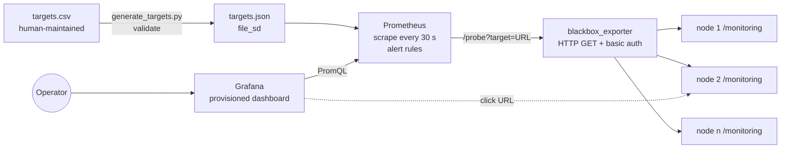
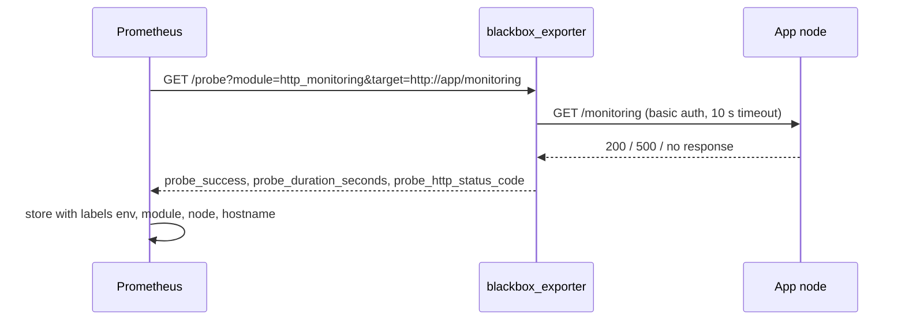

# endpoint-monitoring-stack: Design document

| | |
|---|---|
| Author | Sallehuddin Mohd Zakinuddin |
| Status | v1.0.0 implemented |
| Last updated | November 2026 |

## 1. Context

A multi-module Java application runs on hundreds of application server nodes across several environments. Each node
exposes a JavaMelody `/monitoring` page behind basic authentication. The operations team checked health by opening
those pages one at a time. There was no single view of what was down, no early warning for slow nodes, and the list of
URLs lived in a spreadsheet that drifted from reality.

## 2. Goals and non-goals

**Goals**

1. One dashboard that shows every node's availability and response time.
2. A two-step workflow: find the failing node in Grafana, then click through to its own monitoring page.
3. Alerts for a node down, a node slow, and a whole module down.
4. The inventory is a simple CSV that non-developers can maintain; everything else is generated or provisioned.
5. One command to deploy on any Docker host.

**Non-goals**

- Collecting JVM internals (heap, SQL timings) in Grafana. The deep dive stays on each node's own page.
- Log aggregation or tracing.
- High availability of the monitoring stack itself (single host is acceptable at this stage).

## 3. Architecture

### How a probe works

### Components

| Component | Configuration | Role |
|---|---|---|
| `scripts/generate_targets.py` | `targets.csv` → `prometheus/targets/targets.json` | Validates the inventory and writes file-based service discovery |
| Prometheus | `prometheus/prometheus.yml`, `alerts.yml` | Schedules probes through relabelling, stores results 15 days, evaluates alerts |
| blackbox_exporter | `blackbox/blackbox.yml` | Performs the HTTP request with credentials read from a file |
| Grafana | `grafana/provisioning/*`, `grafana/dashboards/*.json` | Data source and dashboard loaded from files at start-up |
| Mock app (`mock/app.py`) | `MODE` env var: ok, slow, error, flaky | Lets the demo and CI run without real servers |

## 4. Key decision: blackbox probing instead of native JavaMelody metrics

| | Native scrape (`?format=prometheus`) | blackbox probe (chosen) |
|---|---|---|
| Data | JVM heap, SQL timings, hit counts | Up/down, response time, HTTP code |
| Version needed | JavaMelody 1.73 or later | Any version |
| Change on servers | Upgrade JavaMelody in every application | None |
| Result on our servers (older JavaMelody) | HTTP 500 on every node | Works |

The servers ran an older JavaMelody release that predates the Prometheus export, and requests for it returned
HTTP 500. Upgrading every application only for monitoring was not realistic. A blackbox probe requests the same page a
person would open, so it works with any version. The lost JVM detail is acceptable because the workflow already sends
the operator to that page for the deep dive. If the fleet is upgraded later, a native scrape job can be added beside
the probe job without removing it.

## 5. Other decisions

| Decision | Alternatives | Reason |
|---|---|---|
| File-based service discovery from CSV | Static config in `prometheus.yml`; Consul | Non-developers can edit a CSV; Prometheus reloads the JSON without a restart |
| Validation in the generator (duplicates, URL scheme, empty fields) | Trust the CSV | Bad rows fail loudly at generation time rather than as silent missing targets |
| Every stat count uses `… OR vector(0)` | Plain `count()` | A query with no matching series shows "No data" instead of 0, which looks like a fault |
| Alerts use `for:` durations | Fire immediately | One failed probe from a network blip should not page anyone |
| Password from a file (`password_file`) | Inline in YAML | Keeps credentials out of the main config and easy to exclude from Git |
| Pinned image versions | `latest` | Reproducible deployments; upgrades are deliberate |

## 6. Label model

| Label | Source | Used by |
|---|---|---|
| `instance` | The URL (relabelled from `__address__`) | Clickable link in the node table |
| `env` | CSV | Filter, alert text, `ModuleFullyDown` grouping |
| `module` | CSV | Filter, `ModuleFullyDown` grouping |
| `node` | CSV | Tables, legends, alert summaries |
| `hostname` | CSV | Quick identification of the machine |

## 7. Testing strategy

| Level | What it proves |
|---|---|
| Unit (`tests/test_config.py`) | Generator output shape, rejection of duplicates, bad URLs and missing columns; committed `targets.json` matches the CSV; dashboard panel ids unique, every query scoped to the job, stat counts protected with `OR vector(0)` |
| Config | `promtool check config` validates Prometheus config and alert rules in CI |
| Smoke (CI) | Full Compose stack with mock apps starts; CI waits until all six targets have a `probe_success` series |
| Manual end-to-end | Run with real Prometheus and blackbox_exporter binaries against healthy, slow, failing and unreachable mock services: every case reported correctly and alerts moved to pending |

## 8. Operational considerations

- **Placement:** the monitoring host must reach every target network. Test with `curl` from that host before assuming
  a subnet is covered.
- **Capacity:** probes are light. 400 targets every 30 s is about 13 requests per second across the fleet.
- **Retention:** 15 days by default (`--storage.tsdb.retention.time`).
- **Security:** Grafana admin password from an environment variable; the monitoring password from a file excluded
  from Git in real deployments.

## 9. Future work

1. Alertmanager with email or Microsoft Teams receivers.
2. A native JavaMelody scrape job for nodes on 1.73 or later.
3. SLO panels (monthly availability per module).
4. Move to a dedicated host and add a second Prometheus for redundancy.
